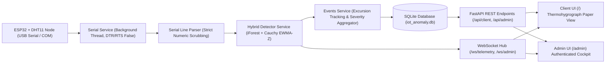

# System Architecture: AI-Based IoT Sensor Anomaly Detection

## 1. End-to-End System Pipeline

---

## 2. Core Components & Responsibilities

### Hardware & Ingestion
- **Hardware Node**: ESP32 microcontroller with DHT11 temperature and relative humidity sensor on GPIO 4. Streams formatted ASCII text `temperature,humidity\n` at 0.5 Hz cadence over 115,200 baud USB-UART.
- **Serial Reader Service (`backend/services/serial_service.py`)**: Exactly one dedicated background thread owns the COM port. Port auto-detection excludes Bluetooth virtual ports and prioritizes USB-UART adapters (CP210x, CH340, FTDI). Sets `dtr=False` and `rts=False` before opening to avoid unwanted bootloader resets.
- **Serial Parser (`backend/services/serial_parser.py`)**: Rejects headers, boot banners, non-numeric noise, missing fields, NaNs, infinities, and physical out-of-range sensor spikes.

### Inference & Detection Engine
- **Detector Service (`backend/services/detector_service.py`)**: Runs an in-sample trained Isolation Forest (200 trees, 12 features) with 3-of-5 persistence gating combined with an Adaptive Cauchy EWMA-Z residual detector (`halflife = 2400s`, rate-gated to avoid post-event baseline poisoning).
- **Safety Assert**: Refuses to start if the loaded threshold feature column schema does not strictly match `MODEL_FEATURE_COLS`.

### Event Aggregator & State Persistence
- **Events Service (`backend/services/events_service.py`)**: Groups contiguous anomalous rows into coherent physical incidents. Computes peak temperature, peak humidity, duration, and human-readable natural language excursion summaries. Assigns severity (`Low`, `Medium`, `High`) based on persistence and deviation from normal baselines.
- **SQLite Database (`backend/database.py`)**: Persists sensor readings, event logs, settings, and audit trails.

### Communication & Presentation Layers
- **FastAPI Application (`backend/app.py`)**: Serves public client endpoints, token-authenticated admin endpoints, real-time WebSocket telemetry, and the bundled single-page application.
- **Client UI (`/`)**: Follows the digital thermohygrograph aesthetic (`iot-client-ui` specification). Displays continuous dual-trace strip chart (`#9B2C2C` temperature, `#1D5C8C` humidity), phase-space room map, and plain-English unusual event log on cream ruling paper (`#EEF1EF`). Strictly client-safe with zero ML terminology.
- **Admin UI (`/admin`)**: Protected by constant-time password check and signed expiring tokens. Provides serial device management, simulation replay, honest 4-label metric audits, and system configuration.

---

## 3. Technology Stack & Constraints

- **Backend**: Python 3.14, FastAPI, Uvicorn, Pydantic, PySerial, SQLite3, HMAC / ItsDangerous, Scikit-learn, Pandas.
- **Frontend**: React 19, Vite, Tailwind CSS, modular D3 (`d3-scale`, `d3-shape`, `d3-axis`, `d3-array`), self-hosted fonts (`@fontsource/literata`, `@fontsource/atkinson-hyperlegible`).
- **Zero CDN Guarantee**: All assets, scripts, stylesheets, and fonts are compiled and served directly from local disk. Zero requests are routed to third-party CDNs.
